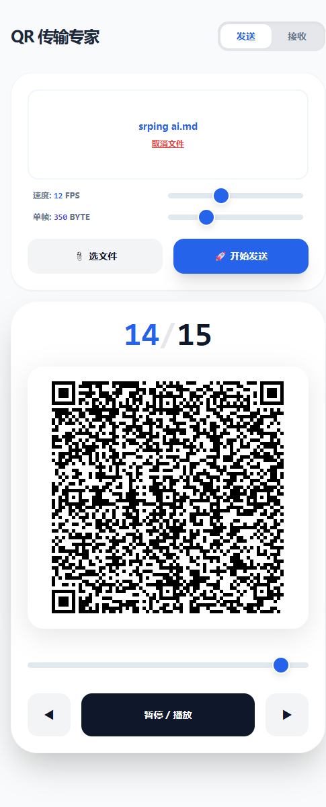
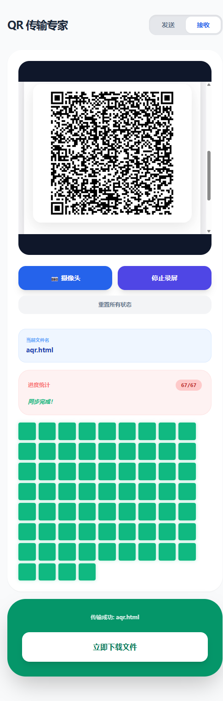

# AirScan-QR 📡

**AirScan-QR** 是一款专为**物理隔离环境 (Air-gapped)** 及 **跨端受限网络** 设计的高效文件传输方案。它把文件编码成**彩色图标矩阵条码（Color Icon Matrix Barcode）**的动态序列，利用“屏幕+摄像头”的视觉链路传输数据，彻底打破物理与协议的边界。

> **v1.1**：编码/解码引擎升级为 [sz3/libcimbar](https://github.com/sz3/libcimbar) 的彩色图标矩阵码优化实现（WASM 本地运行），实测 **4 MB 图片约 1 分钟传完，平均速率约 70 KB/s**。

## 🌟 核心场景

在无法连接互联网、禁用 U 盘、或无法建立局域网共享的场景下，AirScan-QR 是你的最佳选择：

* **封闭开发/实验室环境**：从物理隔离的内网 PC 中取出日志、代码片段或小文件。
* **跨设备“无协议”互传**：手机与手机之间、Android 与 iOS 之间，无需蓝牙或 WiFi，开码即传。
* **远程桌面/VPN 穿透**：直接通过摄像头扫描远程桌面窗口中的二维码，将文件从远程服务器“拿”回本地 PC。
* **无痕传输**：无需安装驱动，无需注册账号，所有逻辑在浏览器本地执行，不留物理痕迹。


## 🚀 快速上手

### 方案 A：手机 ↔ 手机（移动互传）

1. 两台设备均访问：[https://topcss.github.io/AirScan-QR/](https://topcss.github.io/AirScan-QR/)
2. **发送方**：粘贴文本，或点击“选文件” -> 调整帧率（5–20 FPS）与模式（默认 `B`，追求速度选 `4C`）-> 开始发送。
3. **接收方**：点击“开始扫描” -> 对准发送方屏幕 -> 进度到 100% 后自动触发下载。

### 方案 B：PC → 手机（内网提取）

1. 内网 PC 双击 `AirScan-QR.pyw` 启动本地 HTTPS 服务 -> 用浏览器打开提示的地址。
2. 发送方选择文件并广播（Windows 需允许防火墙放行该端口）。
3. 手机扫码接收，实现文件“出网”。

### 方案 C：远程 PC → 本机 PC（穿透 VPN/远程桌面）

1. 在远程窗口中运行发送端并显示彩色条码。
2. 本机 PC 选择“屏幕录制”，选中对应的远程窗口，即可接收文件。


## 📸 界面预览 (UI Preview)

| 发送端界面 (Sender) | 接收端界面 (Receiver) |
| :---: | :---: |
|  |  |
| **功能**：文本/文件输入、帧率与码型调节、实时广播状态 | **功能**：摄像头/屏幕解码、喷泉码重组、自动下载与文本预览 |


## ✨ 功能亮点

* ⚡ **高密度彩色条码**：基于 [libcimbar](https://github.com/sz3/libcimbar) 的彩色图标矩阵码方案，单帧信息密度远高于传统二维码，实测平均速率约 **70 KB/s**。
* 🧬 **喷泉码自愈**：数据按 fountain code 编码，漏扫部分帧无需人工补传，接收方攒够任意足够帧数即可还原完整文件。
* 🖥️ **纯前端 + WebAssembly**：C++ 编解码器编译为 WASM，在浏览器内完成编码（WebGL 渲染）与解码，零服务器、零上传。
* 🎚️ **帧率与码型可调**：5–20 FPS 动态调节，`B` / `Bu` / `Bm` / `4C` 四种码型自由组合，兼顾速度与不同摄像头的识别能力。
* 🔍 **自动模式识别**：接收端“自动”模式轮询四种码型，无需与发送端逐项对齐。
* 📄 **文本与文件皆可**：直接粘贴文本即传，或选择任意文件，超长文件名与后缀无损还原。
* 🎨 **双语 + 极简交互**：中英文一键切换，适配手机与 PC，支持摄像头扫码与屏幕录制（穿透远程桌面）。

## ⚡ 实测速度

| 项目 | 实测结果 |
| :--- | :--- |
| 传输 4 MB 图片 | 约 1 分钟 |
| 平均速率 | 约 70 KB/s |
| 发送帧率 | 15 FPS（默认，可调 5–20） |

实际速度受屏幕刷新率、摄像头分辨率与对焦、环境光照、拍摄距离影响；`4C` 彩色模式单帧容量最大，通常最快。接收端会实时显示速率、剩余时间和平均速率。

## 🛠️ 技术原理

```text
文件 / 文本
    ↓  喷泉码分片
彩色图标矩阵条码（逐帧渲染）
    ↓  屏幕播放 / 窗口显示
摄像头 · 屏幕录制
    ↓  WASM 解码
喷泉码重组 → 原文件还原
```

* **编码**：调用 libcimbar 的 WASM 编码器（`cimbare_encode`），把数据切成可自愈的喷泉码帧序列，再由 WebGL 渲染到 canvas 逐帧播放。
* **解码**：接收端将摄像头/屏幕画面送进 WASM 解码器（`cimbard_fountain_decode`），累计到足够帧后自动重组并下载。
* **丢帧自愈**：喷泉码让“漏几帧”变成概率问题而非失败，无需人工点选补帧。
* **零服务器依赖**：全部计算在浏览器本地完成，数据不经过任何中转，隐私安全无忧。


## 📦 部署与使用

新版依赖 WASM 编解码器，**必须通过 HTTP(S) 访问**（`file://` 直接双击打开无法加载 `.wasm`；换协议或文件后请强刷一次缓存）：

1. **一键本地服务（推荐）**：双击 `AirScan-QR.pyw`，选端口后点“启动”，自动打开 `https://127.0.0.1:<端口>/`。手机当接收端须用 HTTPS（内置自签证书，浏览器提示“不安全”时点“继续前往”）。
2. **在线访问**：直接使用 GitHub Pages 上部署好的页面。
3. **内网分发**：把 `index.html`、`cimbar_js.js`、`cimbar_js.wasm` 三个文件放在同一目录，交给任意静态服务器托管（需正确返回 `application/wasm` MIME）。

> `index-embedded.html` 为 v1.0 之前的单码二维码单文件版，免外部依赖，可作为兼容备份。

## 🏷️ 版本介绍

| 版本 | 入口 | 技术路线 |
| :--- | :--- | :--- |
| **v1.1（当前）** | [index.html](https://topcss.github.io/AirScan-QR/index.html) | libcimbar 彩色图标矩阵码 + 喷泉码，WASM 本地编解码，实测约 70 KB/s |
| v1.0 | `index.html`（旧版，tag `v1.0`） | 动态二维码序列流，单码循环播放，支持摄像头扫码与 PC 跨应用扫码 |
| — | [airscan-fountain.html](https://topcss.github.io/AirScan-QR/airscan-fountain.html) | 喷泉码四码同传，解决丢帧重传问题，效率显著提升 |
| — | `index-embedded.html` | 旧版嵌入式单文件（内联二维码库），U 盘随身携带 |

> `v1.1` 是切换为 cimbar 彩色条码引擎后的第一个版本；`v1.0` 及更早的标签保留为旧二维码引擎的归档。

### 更新日志

* **v1.1**：编码引擎切换为 [libcimbar](https://github.com/sz3/libcimbar) 彩色图标矩阵码；新增 `B/Bu/Bm/4C` 码型与接收端自动识别、文本直传、中英双语；实测 4 MB ≈ 1 分钟（约 70 KB/s）。
* **v1.0**：单码动态二维码方案稳定版，支持缺失帧单点重传、超长文件名还原、深色模式。

## 📜 许可证

MIT License © [Jack/topcss]


## 待解决事项

- [ ] [召集令：挑战视觉传输效率极限 (Screen-to-Camera) ](https://github.com/topcss/AirScan-QR/issues/3) **邀请各位散修，我们创造最高效的视觉传输方案。**

## 鸣谢散修

- [x] airscan-fountain.html 实现了喷泉码，四码同传，效率极高，但是简单的文本会导致卡死，哪位朋友有空可以看看。 **感谢 [@YILS-LIN](https://github.com/YILS-LIN) 解决**
- [x] v1.1 的彩色图标矩阵码编解码引擎来自 **[@sz3](https://github.com/sz3)** 的 [libcimbar](https://github.com/sz3/libcimbar)，站在巨人的肩膀上。